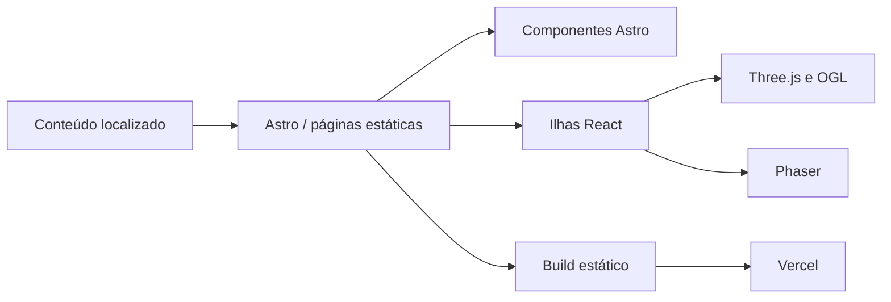

<div align="center">


# Portfolio PS2

**Portfólio bilíngue inspirado na interface do PlayStation 2, com experiências 3D, projetos interativos e um minijogo integrado.**

[](https://github.com/Gust4v0Di4sC/Portfolio-new/actions/workflows/ci.yml)
[](https://astro.build/)
[](https://www.typescriptlang.org/)

[Visão geral](#sobre) · [Executar localmente](#executando-localmente) · [Reportar problema](https://github.com/Gust4v0Di4sC/Portfolio-new/issues)

</div>

---

<p align="center">
  
</p>

## Sobre

**Portfolio PS2** é o portfólio de Gustavo Dias, desenvolvedor Front-end e UI/UX Designer. A experiência transforma a navegação clássica do PlayStation 2 em uma interface web responsiva para apresentar projetos, trajetória profissional, habilidades e formas de contato.

O projeto combina geração estática com ilhas interativas, cenas 3D e conteúdo localizado em português e inglês, com foco em **identidade visual, acessibilidade e performance**.

## Funcionalidades

- **Interface inspirada no PlayStation 2** — splash screen, menu orbital e navegação com estética de console.
- **Portfólio bilíngue** — conteúdo completo em português e inglês, com preferência de idioma persistida.
- **Projetos em Memory Cards** — galeria separada por status, prévias em vídeo, métricas e links externos.
- **Experiências 3D** — cenas e animações construídas com Three.js e OGL.
- **Minijogo integrado** — “Fuga do Buraco Negro”, desenvolvido com Phaser e recorde salvo localmente.
- **Qualidade automatizada** — testes unitários, E2E, acessibilidade e Core Web Vitals executados pela CI.

## Tecnologias

| Área          | Tecnologias                                   |
| ------------- | --------------------------------------------- |
| Base          | Astro, TypeScript                             |
| Interface     | React, CSS                                    |
| 3D e animação | Three.js, OGL                                 |
| Jogo          | Phaser                                        |
| Testes        | Vitest, Playwright, Testing Library, axe-core |
| Qualidade     | ESLint, Prettier, Astro Check                 |
| Deploy        | Vercel, geração estática                      |

## Arquitetura



O Astro é responsável pelas páginas, layouts, SEO e conteúdo estático. Componentes React são hidratados apenas nas áreas interativas, enquanto as experiências visuais e o minijogo permanecem isolados em módulos próprios.

```text
src/
├── components/    # Componentes Astro e ilhas React
├── content/       # Conteúdo localizado e tipos compartilhados
├── game/          # Regras, assets e runtime do minijogo
├── layouts/       # Estrutura compartilhada das páginas
├── pages/         # Rotas em português, inglês e robots.txt
├── scripts/       # Cenas 3D, áudio e efeitos visuais
└── styles/        # Tokens e estilos globais
```

## Executando localmente

### Requisitos

- Node.js 24
- pnpm 10.25.0

```bash
git clone https://github.com/Gust4v0Di4sC/Portfolio-new.git
cd Portfolio-new
pnpm install --frozen-lockfile
pnpm astro dev --background
```

O servidor em segundo plano pode ser administrado com:

```bash
pnpm astro dev status
pnpm astro dev logs
pnpm astro dev stop
```

Para definir a URL usada nos metadados, sitemap e URLs canônicas, copie `.env.example` para `.env` e ajuste:

```env
PUBLIC_SITE_URL=https://seu-dominio.com.br
```

Na Vercel, `VERCEL_PROJECT_PRODUCTION_URL` é detectada automaticamente quando `PUBLIC_SITE_URL` não está definida.

## Qualidade e build

```bash
pnpm validate   # Astro Check, ESLint, Prettier e testes unitários
pnpm verify     # Validação, build, E2E, acessibilidade e performance
pnpm build      # Gera o site estático em dist/
pnpm preview    # Serve o build localmente
```

O workflow [`.github/workflows/ci.yml`](.github/workflows/ci.yml) executa `pnpm verify` em pushes e pull requests direcionados à `main`.

## Deploy

O projeto usa `output: "static"` e pode ser publicado diretamente na Vercel sem um adapter de SSR.

```bash
vercel link --yes --project portfolio-ps2
vercel deploy          # Preview
vercel deploy --prod   # Produção
```
